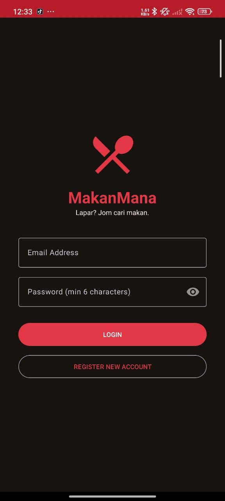
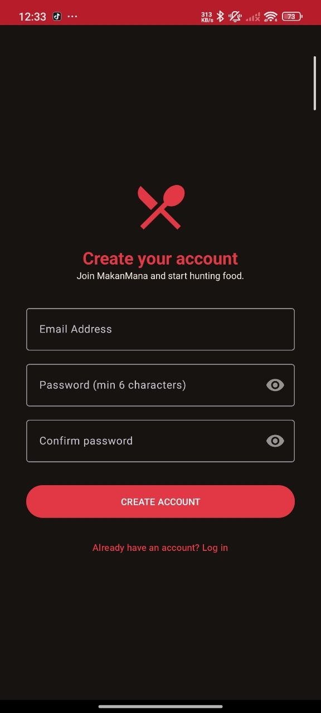
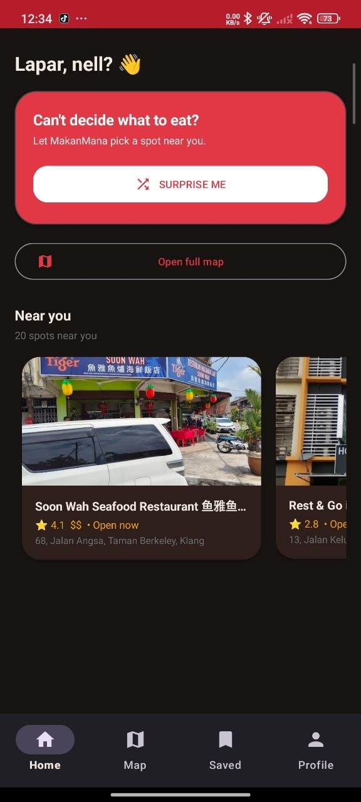
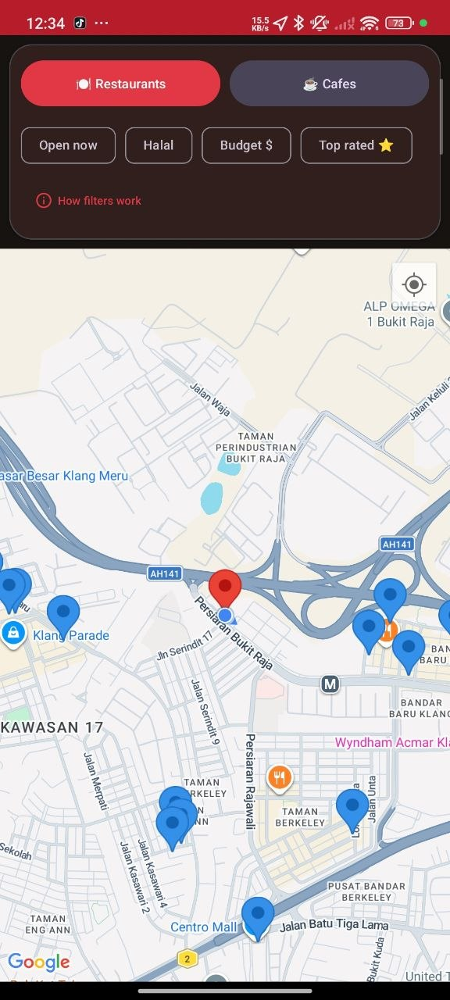
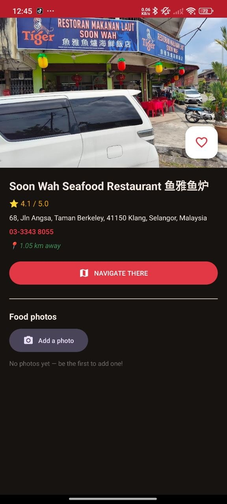
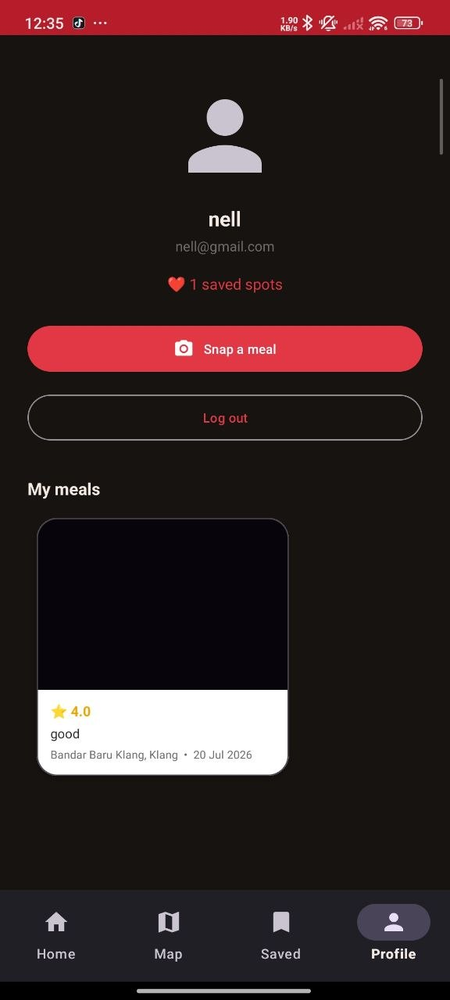
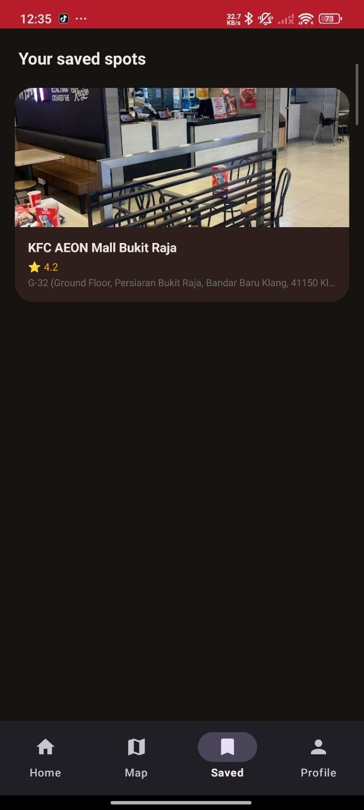
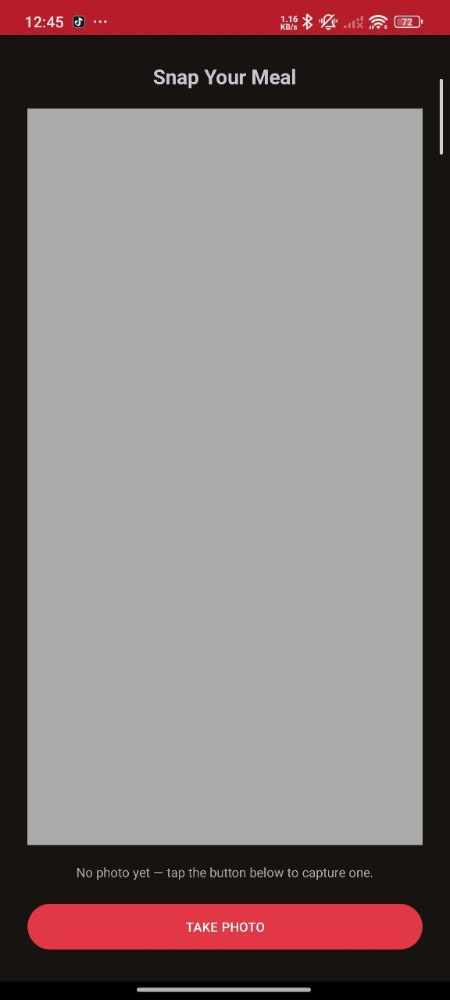

# MakanMana

MakanMana is an Android application built in Java that helps users discover nearby food places, browse a map of restaurants, save favorites, and share meal experiences. The app combines Firebase authentication and Firestore with Google Maps to deliver a modern food-discovery experience.

## Overview

This project is designed for users who want an easy way to:

- discover nearby restaurants and food spots
- filter places by halal, budget, open-now, and rating
- view places on a map with location-aware recommendations
- save favorite places to a personal list
- add photos and notes to places and personal meals
- view a profile with their own saved food memories

## Features

- User registration and login with Firebase Authentication
- Home hub with bottom navigation
- Nearby restaurant discovery via Google Maps
- Smart "Surprise Me" recommendation flow
- Search and filter options for dining preferences
- Favorite places saved in Firestore
- Photo uploads stored with place and meal data
- User profile with personal meal gallery
- Material 3-inspired UI with a warm culinary-themed design

## Tech Stack

- Java
- Android SDK / Android Studio
- Google Maps Android SDK
- Firebase Authentication
- Firebase Firestore
- Google Play Services
- Glide for image loading
- Material Components

## Project Structure

```text
MakanMana/
├── app/
│   ├── src/
│   │   ├── androidTest/
│   │   ├── main/
│   │   │   ├── java/
│   │   │   ├── res/
│   │   │   └── AndroidManifest.xml
│   │   └── test/
│   ├── build.gradle
│   ├── google-services.json
│   ├── proguard-rules.pro
│   └── .gitignore
├── gradle/
├── build.gradle
├── gradle.properties
├── gradlew
├── gradlew.bat
├── settings.gradle
├── local.defaults.properties
├── MAKANMANA_SETUP.md
├── MakanMana_Storyboard.png
├── screens/
│   ├── appicon.jpg
│   ├── login.jpg
│   ├── register.jpg
│   ├── homescreen.jpg
│   ├── map.jpg
│   ├── placedetails.jpg
│   ├── favspot.jpg
│   ├── profile.jpg
│   └── snapmeal.jpg
├── .gitignore
└── README.md
```

## Prerequisites

Before running the project, make sure you have:

- Android Studio installed
- JDK 11 or newer
- A Firebase project configured for the app
- A Google Maps API key

## Setup Instructions

1. Clone the repository.
2. Open the project in Android Studio.
3. Sync Gradle when prompted.
4. Configure your Google Maps API key in `local.properties`:

```properties
MAPS_API_KEY=your_api_key_here
```

5. Ensure the Firebase configuration file `app/google-services.json` is present.
6. In Firebase Console, enable:
   - Authentication -> Email/Password
   - Firestore Database
7. Create the Firestore database in test mode for development.
8. Build and run the app on an emulator or Android device.

For additional notes about Firebase configuration and project setup, see `MAKANMANA_SETUP.md`.

## Firebase and Data Notes

The app stores user favorites and photo data in Firestore. Photos are encoded as Base64 rather than using Cloud Storage, which keeps the app compatible with the free Firebase Spark plan and avoids additional storage costs.

Key collections include:

- `users/{uid}/favourites`
- `users/{uid}/photos`
- `places/{placeId}/photos`

## Screenshots

















## Notes

This repository is a Java-based Android app and appears to be a personal project focused on discovering food and dining experiences with location-aware and social-style features.

## License

No explicit license file is included in the repository at this time.
